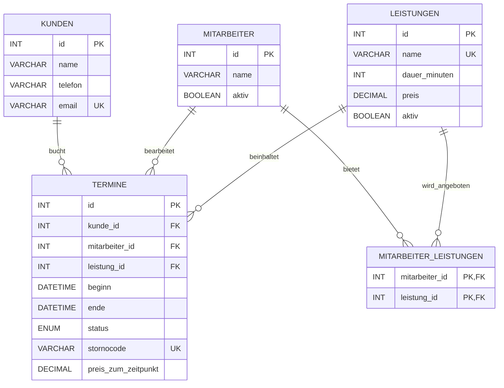

# ER-Diagramm – Schnittpunkt

## Beziehungen

- Ein Kunde kann mehrere Termine buchen.
- Ein Mitarbeiter kann mehrere Termine übernehmen.
- Eine Leistung kann in mehreren Terminen vorkommen.
- Mitarbeiter und Leistungen haben eine n:m-Beziehung.
- Die Tabelle `mitarbeiter_leistungen` bildet diese n:m-Beziehung ab.
- Jeder Termin verweist auf genau einen Kunden, einen Mitarbeiter und eine Leistung.

## Hinweise

`PK` bedeutet Primärschlüssel.

`FK` bedeutet Fremdschlüssel.

`UK` bedeutet eindeutiger Schlüssel (UNIQUE).

Der Preis zum Buchungszeitpunkt bleibt im Termin gespeichert.
